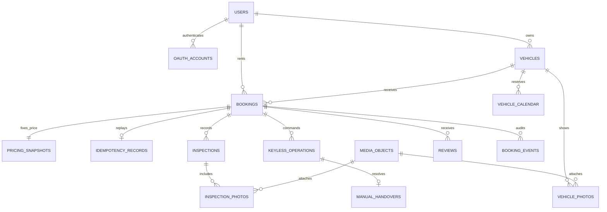

# Thiết kế dữ liệu Car Sharing

Phiên bản 1.1, 27/10/2026. PostgreSQL và Prisma. Đây là thiết kế để viết migration ở giai đoạn G0; chưa có database đã triển khai. Dùng snake_case trong SQL, UUID PK, timestamptz cho thời gian và bigint VND trong DB; API serialize sang JSON number sau khi kiểm tra giới hạn số nguyên an toàn.

## Bảng và ràng buộc

| Bảng | Trường nghiệp vụ chính | Ràng buộc và chỉ mục |
| --- | --- | --- |
| users | id, name, email_normalized, phone, password_hash nullable, created_at | UNIQUE email_normalized; mật khẩu nullable cho OIDC |
| oauth_accounts | id, user_id, provider, subject | UNIQUE(provider,subject); FK user; không tự link theo email |
| refresh_sessions | id, user_id, token_hash, family_id, expires_at, revoked_at, replaced_by | UNIQUE token_hash; index family_id; không lưu refresh thô |
| vehicles | id, owner_id, brand, model, year, plate_normalized, city, pickup_address, car_type, transmission, seats, description, price_per_day_vnd, keyless_supported, status, version | UNIQUE plate_normalized; CHECK giá > 0 và <= 100 triệu; index(status,city,price_per_day_vnd) |
| vehicle_amenities | vehicle_id, amenity_code | PK(vehicle_id,amenity_code); mã danh mục allowlist |
| media_objects | id, uploader_id, purpose, vehicle_id?, booking_id?, staging_key, final_key, mime_type, size_bytes, checksum, state, verified_at | UNIQUE final_key; CHECK 0 < size_bytes <= 5242880; CHECK scope đúng purpose; state=STAGING/VERIFIED/REJECTED |
| vehicle_photos | vehicle_id, media_id, position | PK(vehicle_id,media_id); UNIQUE(vehicle_id,position); media phải VERIFIED, purpose VEHICLE_PHOTO |
| bookings | id, vehicle_id, renter_id, owner_id, start_at, end_at, status, request_expires_at, completed_at?, reason?, version, created_at | CHECK end_at > start_at; renter_id <> owner_id; index(renter_id,created_at), (owner_id,status), (status,request_expires_at); unique active trip theo vehicle |
| pricing_snapshots | id, booking_id, currency, price_per_day_vnd, rental_days, subtotal_vnd, service_fee_vnd, deposit_vnd, total_vnd, pricing_version | UNIQUE booking_id; currency=VND; CHECK thành phần không âm và total=subtotal+fee+deposit; không cập nhật sau commit |
| idempotency_records | id, actor_id, operation, key, request_hash, booking_id, created_at | UNIQUE(actor_id,operation,key); FK booking; chỉ lưu kết quả thành công trong transaction tạo booking |
| vehicle_calendar | id, vehicle_id, booking_id?, kind, start_at, end_at, reason?, released_at? | UNIQUE booking_id; kind=BOOKING/OWNER_BLOCK; CHECK start < end; CHECK booking_id theo kind; GiST exclusion khoảng active |
| inspections | id, booking_id, type, odometer_km, fuel_percent, damage_notes, acknowledged, finalized_at?, version, performed_by | UNIQUE(booking_id,type); CHECK odo >= 0, fuel 0–100; AFTER odo >= BEFORE được kiểm tra transaction |
| inspection_photos | inspection_id, angle, media_id | PK(inspection_id,angle); angle FRONT/REAR/LEFT/RIGHT; UNIQUE(inspection_id,media_id) |
| keyless_operations | id, booking_id, actor_id, action, idempotency_key, request_hash, status, provider, device_result?, lease_until?, created_at, resolved_at? | UNIQUE(actor_id,booking_id,action,idempotency_key); unique unresolved operation theo booking; adapter nhận id làm commandId |
| manual_handovers | id, booking_id, operation_id, action, reason, owner_confirmed_at?, renter_confirmed_at?, finalized_at? | UNIQUE operation_id; hai người xác nhận khác vai trò; hoàn tất đúng một lần |
| reviews | id, booking_id, author_id, target_user_id, score, comment, created_at | UNIQUE(booking_id,author_id); CHECK score 1–5 và author <> target; người tham gia kiểm tra server |
| booking_events | id, booking_id, actor_id?, event_type, from_status?, to_status?, reason?, operation_id?, created_at | Append-only; index(booking_id,created_at); không lưu token/URL ký |
| notifications | id, user_id, booking_id?, event_id, type, read_at?, created_at | UNIQUE(user_id,event_id,type); ghi cùng transaction sự kiện nghiệp vụ |

Các bảng dùng FK onDelete RESTRICT cho booking, snapshot và bằng chứng. Chưa hard-delete lịch sử booking trong MVP. Việc archive xe không xóa lịch sử. Cross-table rules như owner_id đúng chủ xe, media đúng booking và author là người tham gia được kiểm tra server trong transaction; FK đơn lẻ không chứng minh các điều kiện này.

## Constraint lịch và một chuyến đang chạy

Migration cần thêm raw SQL vì thiết kế này sử dụng PostgreSQL range/exclusion constraint. Kiểm tra migration trên DB rỗng và DB thử có dữ liệu. Exclusion constraint là cơ chế cuối cùng chặn lịch giao nhau; application vẫn phải map lỗi sang mã nghiệp vụ.

```sql
CREATE EXTENSION IF NOT EXISTS btree_gist;

ALTER TABLE vehicle_calendar
  ADD CONSTRAINT vehicle_calendar_period_valid
  CHECK (start_at < end_at);

ALTER TABLE vehicle_calendar
  ADD CONSTRAINT vehicle_calendar_no_overlap
  EXCLUDE USING gist (
    vehicle_id WITH =,
    tstzrange(start_at, end_at, '[)') WITH &&
  ) WHERE (released_at IS NULL);

CREATE UNIQUE INDEX bookings_one_in_progress_per_vehicle
  ON bookings(vehicle_id) WHERE status = 'IN_PROGRESS';

CREATE UNIQUE INDEX keyless_one_unresolved_per_booking
  ON keyless_operations(booking_id)
  WHERE status IN ('PENDING', 'UNKNOWN');
```

Không đặt điều kiện NOW() trong index/constraint. REQUESTED hết hạn được đổi EXPIRED và calendar được released trong cùng transaction. Worker và API lười dọn hạn đều dùng khóa vehicle. Search bỏ qua hold hết hạn trong query, không chờ worker. APPROVED giữ lịch đến khi hủy/hoàn tất theo quy tắc, không tự expire bằng request_expires_at.

## Giao dịch tạo booking

1. Xác thực actor, key và định dạng DTO; chuẩn hóa thời gian và tạo requestHash.
2. Tìm idempotency theo actor/scope/key. Nếu có, kiểm tra hash và quyền rồi trả booking/snapshot hiện tại; không kiểm tra lại điều kiện ngày tương lai của lần tạo đầu.
3. Mở transaction READ COMMITTED, SELECT vehicle FOR UPDATE theo UUID bằng truy vấn tham số hóa. Thứ tự khóa cố định vehicle → booking → operation; thao tác nhiều xe phải khóa UUID tăng dần.
4. Kiểm tra idempotency lại; xử lý REQUESTED hết hạn của xe; kiểm tra PUBLISHED, chủ xe, chuyến IN_PROGRESS quá giờ chưa trả, owner block và calendar overlap.
5. Tính giá từ đơn giá đang khóa; đối chiếu expectedTotalVnd/pricingVersion. Ghi booking, snapshot, calendar, idempotency, event và notification. Snapshot có FK booking_id; không cần vòng FK booking.snapshot_id, API lấy snapshotId từ relation unique.
6. Commit rồi trả 201. Unique idempotency bị tranh chấp: rollback, đọc bản ghi đã commit và so hash để replay 200 hoặc 409. SQLSTATE 23P01 của exclusion là 409 VEHICLE_UNAVAILABLE; 23505 phải phân biệt theo tên constraint, không map tất cả thành replay.
7. Deadlock/serialization có thể retry tối đa 3 lần với backoff, giữ cùng key; không tự retry lỗi nghiệp vụ. Hết retry trả 503 RETRY_LATER; client retry cùng key để giải quyết kết quả commit chưa rõ.

Không gọi Google, S3 hoặc thiết bị trong transaction đang giữ khóa DB. Với Keyless, tạo operation và commit trước; xử lý thiết bị bên ngoài; cập nhật kết quả trong transaction mới. Claim worker dùng lease và chỉ một commandId; hết lease không tự đồng nghĩa thiết bị chưa thực hiện.

## Xe trả muộn

Không cố mở rộng calendar vào một khoảng đã có booking tiếp theo vì sẽ vi phạm constraint. Khi booking IN_PROGRESS vượt endAt, search tạm ẩn xe và create booking mới trả VEHICLE_RETURN_OVERDUE cho đến khi sự cố được xử lý. START của booking kế tiếp bị chặn nếu còn một chuyến IN_PROGRESS, kể cả calendar dự kiến không giao nhau. Sau khi xác nhận trả xe, hoàn tất đơn và thông báo hai bên của chuyến bị ảnh hưởng. Việc đổi lịch/hủy hỗ trợ phải là hành động có audit, không tự ghi đè.

## Mô hình quan hệ



## Kiểm tra migration và dữ liệu thử

Seed gồm 2 owner, 2 renter, 12 xe PUBLISHED, 1 xe DRAFT, xe có owner block và các booking ở từng trạng thái. Dùng UUID cố định cho E2E, mốc thời gian được tạo tương đối theo test clock. Không seed token hoặc credential thật. Test cần thử cả insert calendar trực tiếp để xác nhận constraint và API đồng thời để xác nhận mã lỗi/rollback. Đối chiếu số booking, snapshot, calendar, event và idempotency sau mỗi ca.
