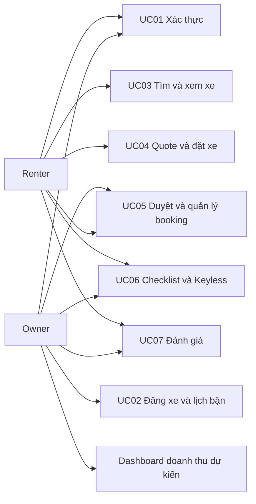
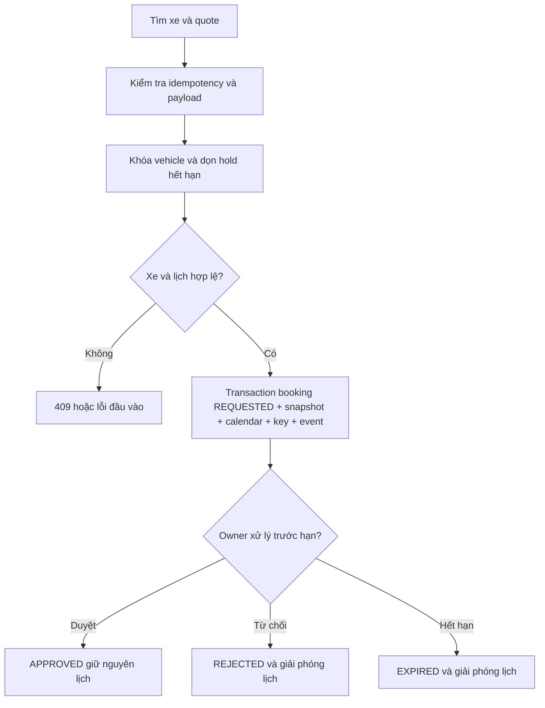
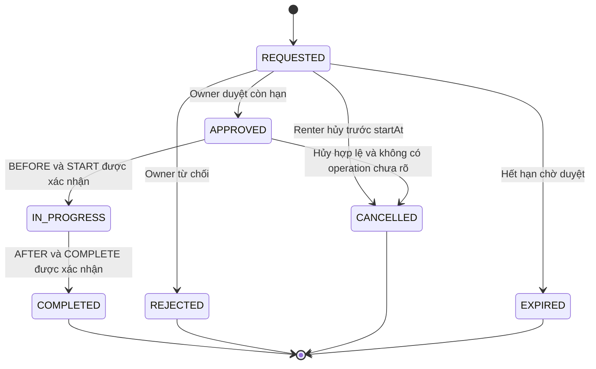
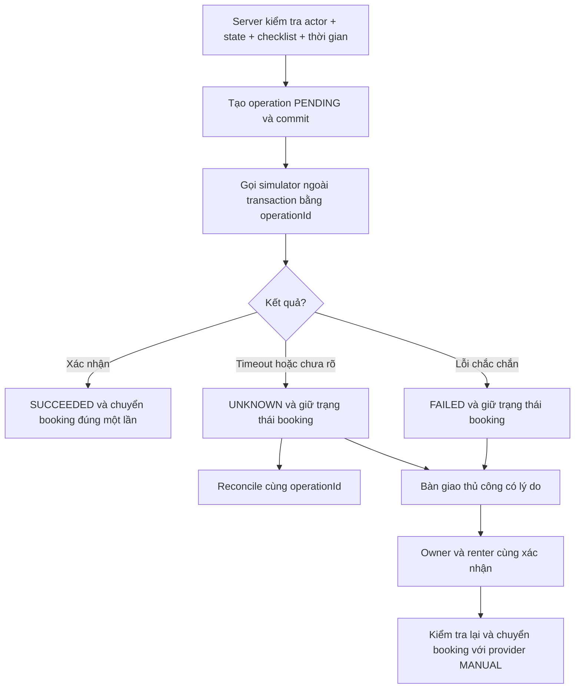
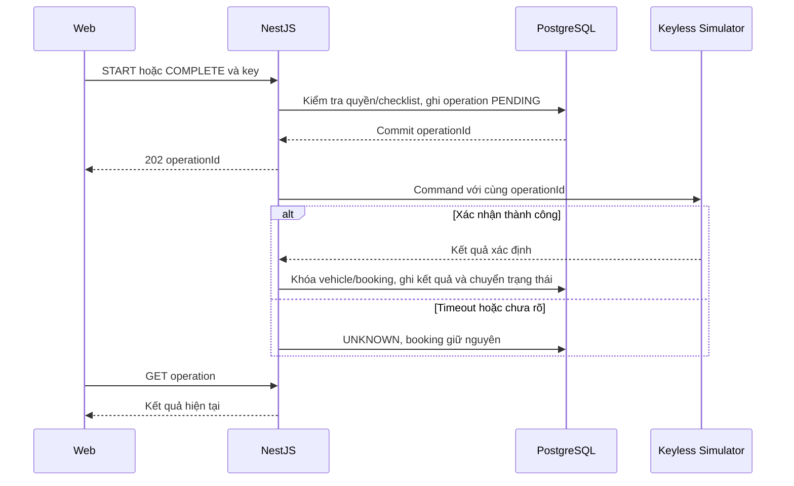

# Nguồn sơ đồ Car Sharing phiên bản 1.1

Các sơ đồ dưới đây áp dụng cùng quy tắc trong SRS.md. Hình trong Word được dựng lại từ các luồng này, không dùng lại sơ đồ giữ lịch từ lúc APPROVED của phiên bản cũ.

## Vai trò và chức năng

## Tạo và duyệt booking

## Trạng thái booking

## Keyless

## Tuần tự thao tác thiết bị

Mô hình ER đầy đủ nằm trong DATABASE_DESIGN.md. Thao tác nhận xe còn kiểm tra không có chuyến IN_PROGRESS khác, kể cả khi lịch dự kiến chỉ tiếp giáp.
