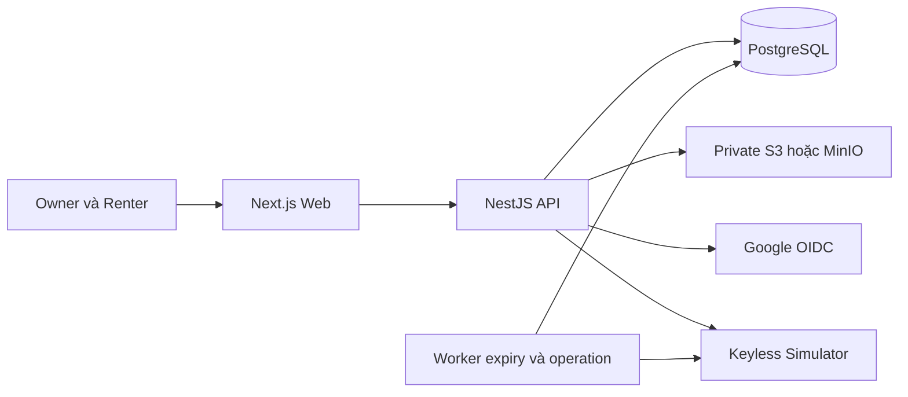

# Kế hoạch xây dựng web Car Sharing

Ngày lập: 27/10/2026. Mục tiêu: web chạy trọn luồng theo đề bài Topic 18, có PostgreSQL thật, OAuth2 Google, upload ảnh và kiểm thử tự động; Keyless được kiểm tra bằng simulator có ghi rõ chế độ mô phỏng.

## Trạng thái hiện tại

- [x] Rà soát đề bài, SRS, quy chuẩn và báo cáo kiểm thử.
- [x] Chốt chính sách nghiệp vụ trong DECISIONS.md và SRS.md.
- [x] Lập hợp đồng API, thiết kế bảng/ràng buộc và kế hoạch nghiệm thu.
- [ ] Khởi tạo repository ứng dụng và dependency lockfile.
- [ ] Có migration, frontend, backend, test thực thi và môi trường demo.

Các mục đã đánh dấu chỉ nói về tài liệu đã chuẩn bị. Chưa ghi nhận build/test ứng dụng thành công. Ước lượng dưới đây là 20–25 ngày làm việc cho nhóm 4 người với các đầu việc có thể thực hiện đồng thời; chốt lại sau G0 dựa trên thời gian thực tế của thành viên. Không phải cam kết ngày giao cố định.

## Kiến trúc triển khai

Next.js dùng TypeScript và Tailwind cho UI. NestJS modular monolith xử lý auth, xe, search, pricing, booking, checklist, Keyless, review và dashboard. PostgreSQL là nguồn dữ liệu chính, Prisma quản lý model/query và SQL migration bổ sung exclusion constraint. MinIO phục vụ private object storage tại local; S3-compatible adapter dùng chung cho môi trường demo.

Web và API được public qua cùng origin, API dưới /api/v1. Auth cookie HttpOnly, CSRF/Origin checks; Google OIDC do backend quản lý. Worker expiration/Keyless dùng cùng codebase và DB, không đưa network call vào transaction giữ khóa xe. Thông báo trong ứng dụng được ghi cùng transaction nghiệp vụ. Redis, Go và email/SMS chỉ bổ sung khi có yêu cầu hoặc số đo cho thấy cần.



## Cấu trúc repository dự kiến

```text
apps/
  web/                  Next.js App Router, UI và web E2E
  api/                  NestJS modules, worker và API tests
packages/
  contracts/            DTO/type sinh từ OpenAPI, không import ORM vào web
  domain/               pricing, overlap, policies thuần TypeScript
  config/               tsconfig và lint dùng chung
prisma/
  schema.prisma
  migrations/           Bao gồm btree_gist và exclusion constraint
  seed.ts
infra/
  compose.yaml          PostgreSQL, MinIO và cấu hình local
docs/                   SRS, quyết định, API, DB, plan và bằng chứng
```

G0 chọn phiên bản ổn định tương thích tại thời điểm scaffold, pin Node LTS và package manager trong repository, commit lockfile; không dùng tag latest trong CI/deploy. Không coi tên folder hoặc lệnh dự kiến dưới đây là các file/script đã tồn tại.

## G0 Nền tảng và vertical slice tối thiểu

Ước lượng 2–3 ngày. Việt phụ trách môi trường và DB, Trí phụ trách API, Tiền phụ trách shell UI, Sang phụ trách pipeline và khung test.

1. Khởi tạo workspace, chọn/pin phiên bản, ESLint/Prettier/strict TypeScript, .gitignore và .env.example không có secret.
2. Compose PostgreSQL/MinIO, migration schema đầu tiên và seed 4 tài khoản, 12 xe PUBLISHED và 1 xe DRAFT; kiểm tra raw exclusion constraint trên DB thật.
3. Health endpoint, error envelope/requestId, validation DTO và OpenAPI. Sinh client contracts cho web.
4. Shell UI tiếng Việt, responsive layout, điều hướng Owner/Renter và các trạng thái tải/rỗng/lỗi.
5. Thiết lập Jest, Supertest, Playwright và CI build/lint/typecheck. Test DB tách hoàn toàn dữ liệu người dùng.

Điều kiện hoàn thành: checkout mới có thể cài dependency theo lockfile, chạy DB/storage, migrate/seed và hiển thị danh sách xe mẫu qua API thật. CI chạy được kiểm tra constraint lịch và smoke UI. Chỉ đánh dấu khi có log thực thi.

## G1 Xác thực và đăng xe

Ước lượng 4 ngày; phụ thuộc G0. Việt chính auth/media, Trí chính vehicle API, Tiền chính giao diện, Sang chính quyền truy cập và upload tests.

- Email/Password, Argon2id, Google Authorization Code, cookie access/refresh, rotation/reuse detection, CSRF, logout và rate limit.
- Vehicle DRAFT/PUBLISHED/ARCHIVED, cập nhật có version, owner blocks và kiểm tra sở hữu.
- Upload staging, verify file và copy final key; ảnh listing/giấy tờ phân purpose; publish yêu cầu ảnh hợp lệ.
- Trang đăng nhập/đăng ký, danh sách xe owner, form đăng/sửa và lịch bận.

Điều kiện hoàn thành: đăng nhập Google bằng cấu hình demo thật; owner tạo và publish được xe; người khác không sửa xe hoặc xem giấy tờ; URL upload cũ không ghi đè ảnh final. Thiếu Google client credentials chỉ được đánh dấu phần Google chưa hoàn tất, không bỏ yêu cầu OAuth2.

## G2 Tìm xe và tính giá

Ước lượng 3 ngày; phụ thuộc listing của G1. Tiền chính UI, Trí chính search/pricing, Việt chính query/index, Sang chính dữ liệu biên.

- Bộ lọc theo API_CONTRACT, phân trang, sort có tie-breaker, chi tiết xe và quote.
- Calculator thuần kiểm tra thời gian, min/max duration, giá VND và safe integer; pricingVersion daily-v1, phí/cọc bằng 0.
- Search dùng cùng [start,end) với booking, bỏ hold đã hết hạn và ẩn xe đang trả muộn chưa giải quyết.

Điều kiện hoàn thành: bộ lọc phản ánh đúng DB; khoảng tiếp giáp không bị loại; không lộ địa chỉ/giấy tờ private; unit tests 1 giờ, 24 giờ ± 1 ms, 30 ngày, invalid date, giá sai và vượt giới hạn đều có assertion độc lập.

## G3 Booking và dashboard yêu cầu

Ước lượng 4–5 ngày; phụ thuộc G2. Trí chính orchestration, Việt chính transaction/constraints, Tiền chính giao diện hai phía, Sang chính concurrency/E2E API.

- Tạo booking với Idempotency-Key và expectedTotalVnd, snapshot bất biến, giữ lịch ngay REQUESTED.
- Khóa vehicle theo thứ tự cố định; cùng transaction ghi booking/snapshot/calendar/idempotency/event/notification.
- Owner duyệt/từ chối, renter hủy, worker EXPIRED và lazy cleanup; phân quyền trực tiếp qua API.
- Trang đơn thuê, chi tiết đơn, inbox yêu cầu owner và thông báo trong ứng dụng.

Điều kiện hoàn thành: 20 request khác key cùng xe/khoảng giờ chỉ tạo 1 booking; request cùng key/cùng body trả cùng ID; khác body trả 409; lỗi có rollback đủ bảng; owner block cạnh tranh booking chỉ có một bên giữ lịch. Review mã không thay thế các ca PostgreSQL đồng thời.

## G4 Checklist và Keyless

Ước lượng 4–5 ngày; phụ thuộc G3 và media của G1. Tiền chính form/mobile, Trí chính operation/adapter, Việt chính bằng chứng/audit, Sang chính success/failure/timeout/retry.

- BEFORE/AFTER draft và finalize đủ 4 góc, odo, fuel, xác nhận và kiểm tra ảnh thuộc booking.
- Keyless operation PENDING/SUCCEEDED/FAILED/UNKNOWN; simulator idempotent theo operationId; API polling/reconcile.
- Chuyển IN_PROGRESS/COMPLETED chỉ khi có xác nhận phù hợp; không giữ DB transaction khi chờ adapter.
- Bàn giao thủ công với hai xác nhận, lý do và audit; xử lý timeout sau khi thiết bị có thể đã thực hiện.
- Trả muộn, chặn nhận xe tiếp theo khi vẫn có IN_PROGRESS; thông báo tình huống cần hỗ trợ.

Điều kiện hoàn thành: UI và API đều chặn thiếu quyền/checklist/khung giờ; timeout không báo mở thành công; retry không tạo thêm lệnh vật lý giả lập; hoàn tất chỉ một lần; manual có hai người xác nhận. Bằng chứng được ghi rõ SIMULATOR, không ghi thiết bị thật đã được kiểm tra.

## G5 Review và nghiệm thu demo

Ước lượng 3 ngày; phụ thuộc G4. Trí chính review/analytics, Tiền chính dashboard, Việt chính môi trường triển khai, Sang chính hồi quy và bàn giao.

- Review hai chiều với unique theo booking/author; điểm xe và điểm renter tổng hợp đúng nguồn.
- Dashboard tiền thuê dự kiến theo completedAt, từ snapshot; không phụ thuộc review, không cộng phí/cọc.
- Responsive 360/768/desktop, form/keyboard, empty/error/loading, dữ liệu demo và hướng dẫn chạy.
- Load test theo NFR đã chốt; truy cập chéo, CSRF, private media, log redaction và database backup/restore rehearsal.
- Chuẩn bị môi trường staging và bản build có thể review; deployment public thực hiện khi có đích triển khai và quyền truy cập phù hợp.

Điều kiện hoàn thành: luồng đầy đủ từ tìm đến đánh giá chạy qua trình duyệt và API, test/coverage/build đạt, README có các bước tái hiện và báo cáo nêu rõ giới hạn. Mục tiêu availability 30 ngày và thiết bị thật chưa đủ bằng chứng phải được ghi riêng.

## Bộ kiểm thử bắt buộc

| Nhóm | Ca cần có | Phụ thuộc |
| --- | --- | --- |
| Unit | Giá/thời gian, overlap tiếp giáp, transition, checklist, review, defensive copy | Jest, clock cố định |
| Integration | Snapshot atomicity, expiry, ownership, idempotency, unique review, private media | PostgreSQL và MinIO thử |
| Concurrency | 20 booking khác key, cùng key khác payload, block vs booking, approve vs expire, complete vs retry | PostgreSQL thật, barrier xác định |
| E2E API | Hai phiên owner/renter đi toàn bộ vòng đời, direct API negative paths | Nest server thật, Supertest |
| Browser | Search → quote → đặt → duyệt → checklist → nhận/trả → review/dashboard | Playwright, simulator, storage thử |
| Phụ thuộc ngoài | Google OIDC callback và failure; S3 credential/config; thiết bị thật nếu bổ sung | Cấu hình sandbox; ghi rõ phần chưa chạy |

Lệnh workspace dự kiến sau G0: `pnpm lint`, `pnpm typecheck`, `pnpm test:unit`, `pnpm test:integration`, `pnpm test:e2e:api`, `pnpm test:e2e:web`, `pnpm build`. G0 phải tạo và chạy các script này; hiện chưa có package.json để chạy.

## Điều kiện sẵn sàng cho mỗi PR

Thay đổi có căn cứ yêu cầu, migration đi kèm, DTO/OpenAPI/client được đồng bộ, quyền tài nguyên kiểm tra server, test đúng rủi ro đã chạy. Tách PR theo chức năng có thể review; mục tiêu dưới 400 dòng là hướng dẫn, không tính máy móc file sinh/lockfile. Một reviewer ngoài tác giả, riêng transaction/auth cần Việt hoặc Trí review chuyên môn; tác giả không tự approve. CI phải đạt trước merge.

Không đặt mật khẩu/secret thật trong seed, README hoặc báo cáo. Không sửa expected chỉ để test đạt. Chỉ công bố đạt NFR có số đo, điều kiện và log tương ứng.

## Rủi ro và cách xử lý

| Rủi ro | Cách xử lý |
| --- | --- |
| Thiếu Google OAuth credentials | G0 liệt kê redirect URI và env cần có; G1 cấu hình; giữ yêu cầu Google pending đến khi test thật |
| PostgreSQL hosting không cho btree_gist | Kiểm tra ngay G0; chọn môi trường cho extension trước khi triển khai, không bỏ constraint im lặng |
| Lịch bị treo do hold/operation | Worker và API lazy cleanup có audit; operation UNKNOWN cần reconcile/manual, không tự coi thành công |
| URL upload còn hiệu lực ghi đè ảnh | Staging và final key tách biệt; final key không cấp quyền ghi client |
| Phần cứng chưa có | Simulator có mode/log rõ; adapter thật là milestone riêng |
| Phạm vi vượt thời gian | Ưu tiên đủ luồng core; Apple/Redis/Go/SMS/payment giữ ngoài MVP |

## Công việc tiếp theo

Bắt đầu G0 bằng khởi tạo workspace ứng dụng, migration và một vertical slice đọc danh sách xe từ PostgreSQL lên Next.js. Đối chiếu tài liệu Word với docs/SRS.md khi thay đổi nghiệp vụ; ghi quyết định mới vào DECISIONS.md trước khi sửa các hợp đồng liên quan.

Khi triển khai bằng Gemini theo từng task, bắt đầu bằng G0-00 trong docs/tasks/G0_TASKS.md để kiểm tra môi trường/phiên bản, sau đó scaffold theo thứ tự prerequisite. Hướng dẫn làm việc ở docs/GEMINI_HANDOFF.md; trạng thái và bằng chứng lưu trong docs/PROGRESS.md.
